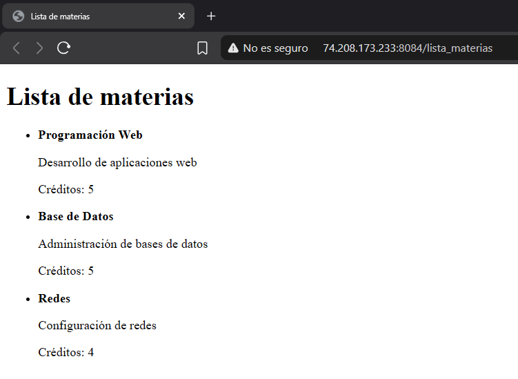
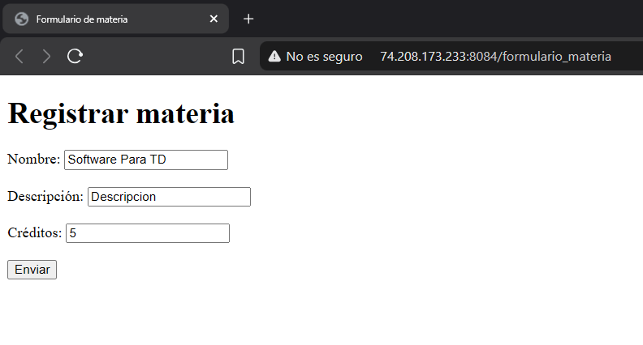
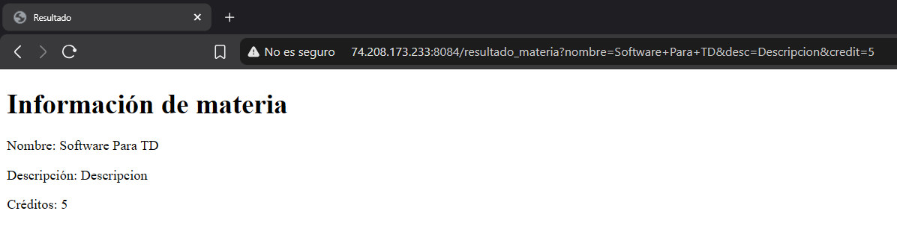
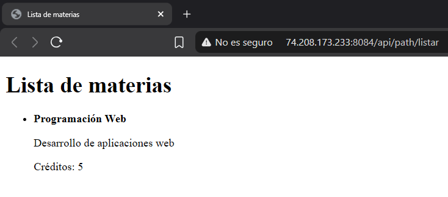
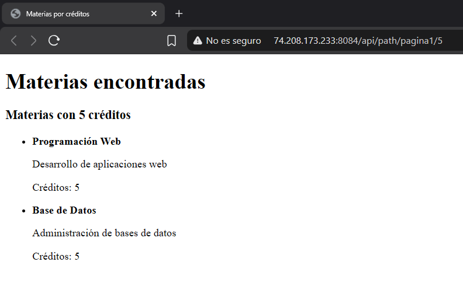
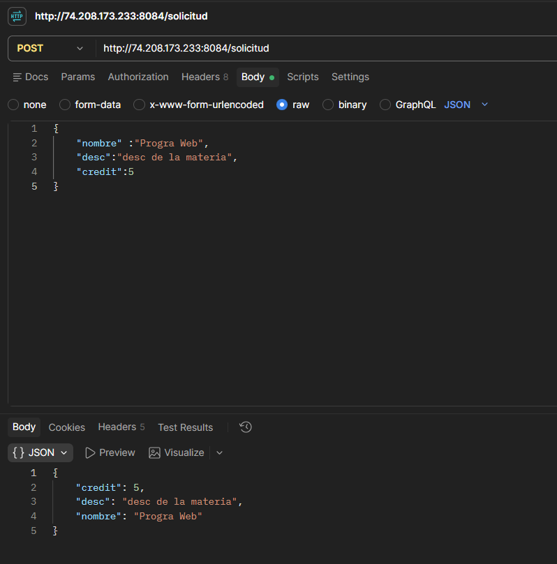

# Proyecto Spring Boot: catálogo de materias

**Autor:** Mariysabel

Aplicación web desarrollada con Spring Boot para practicar controladores MVC,
vistas Thymeleaf, DTOs, formularios, parámetros de URL y endpoints REST. El
ejemplo principal utiliza un catálogo de materias.

## Requisitos

- Java 25 o superior.
- Maven. El proyecto incluye Maven Wrapper.

## Tecnologías

- Spring Boot 4.1.2
- Spring MVC (`spring-boot-starter-webmvc`)
- Thymeleaf mediante `spring-boot-starter-thymeleaf`
- DTOs para transportar datos
- Endpoints REST con JSON

## Ejecutar el proyecto

Desde la carpeta raíz del proyecto:

```powershell
.\mvnw.cmd spring-boot:run
```

La aplicación utiliza el puerto `8084`.

También se puede compilar y ejecutar el archivo JAR:

```powershell
.\mvnw.cmd package
java -jar target/springboot-aplications-0.0.1-SNAPSHOT.jar
```

## DTO utilizado

La clase `MateriaDTO` representa los datos de una materia:

- `nombre`
- `desc`
- `credit`

El DTO se utiliza en los controladores MVC y en el endpoint REST POST.

## Controladores MVC y vistas Thymeleaf

Los controladores MVC se encuentran en:

```text
src/main/java/com/act1/spring/app1/springboot_aplications/controllers/MateriaController.java
src/main/java/com/act1/spring/app1/springboot_aplications/controllers/MateriaCatengoriasController.java
```

### GET /lista_materias

URL completa:

```text
http://localhost:8082/lista_materias
```

Muestra el listado de materias en la vista `lista_materias.html`. El
controlador envía la lista mediante `Model` y la vista recorre los elementos
con:

```html
<li th:each="materia : ${materias}">
```

### GET /formulario_materia

URL completa:

```text
http://localhost:8082/formulario_materia
```

Muestra el formulario de la vista `formulario_materia.html`, con los campos
`nombre`, `desc` y `credit`. Al enviarlo, los datos se mandan a
`/resultado_materia`.

### GET /resultado_materia

URL completa (ejemplo):

```text
http://localhost:8082/resultado_materia?nombre=Redes&desc=Configuracion%20de%20redes&credit=4
```

Recibe los datos del formulario mediante:

```java
@ModelAttribute("materia") MateriaDTO materia
```

Spring llena automáticamente el `MateriaDTO` con los campos del formulario y
la vista `resultado_materia.html` muestra la información recibida.

### GET /api/path/listar?nombre=...

URL completa:

```text
http://localhost:8082/api/path/listar?nombre=Redes
```

Usa `@RequestParam` para recibir el parámetro opcional `nombre`. Filtra las
materias cuyo nombre contenga el texto enviado (sin distinguir mayúsculas). Si
se omite, usa el valor predeterminado `Programación Web`. El resultado se
muestra en `lista_materias.html`.

### GET /api/path/pagina1/{credits}

URL completa:

```text
http://localhost:8082/api/path/pagina1/5
```

Usa `@PathVariable int credits` para filtrar las materias por número de
créditos y mostrarlas en la vista `listar.html`. Si no hay coincidencias,
muestra el mensaje "No se encontraron materias".

### GET /detalles_alumno

URL completa:

```text
http://localhost:8082/detalles_alumno
```

Muestra la información de un empleado y una tabla con la lista de empleados
(`th:each`) en la vista `detalles_alumno.html`.

## Propiedades personalizadas con @Value

En `application.properties` se define:

```properties
config.codigo = 123456
config.nombre = Mariysabel
config.mensaje = hola mundo
```

Los controladores las leen con:

```java
@Value("${config.nombre}")
private String nombre;
```

## Endpoints REST

### POST /solicitud

URL completa:

```text
http://localhost:8082/solicitud
```

Recibe un objeto JSON mediante `@RequestBody MateriaDTO` y lo devuelve como
JSON.

Header:

```text
Content-Type: application/json
```

Body para Postman:

```json
{
  "nombre": "Programación Web",
  "desc": "Desarrollo de aplicaciones web",
  "credit": 5
}
```

Respuesta esperada:

```json
{
  "nombre": "Programación Web",
  "desc": "Desarrollo de aplicaciones web",
  "credit": 5
}
```

### POST /api/vari/solicitud

```text
http://localhost:8082/api/vari/solicitud
```

Recibe un objeto `Empleados` en JSON mediante `@RequestBody` y lo devuelve
como respuesta JSON.

### GET /valores

```text
http://localhost:8082/valores
```

Devuelve en JSON el valor de `config.nombre` configurado con `@Value`.

### GET /api/vari/valores

```text
http://localhost:8082/api/vari/valores
```

Devuelve en JSON los valores `Codigo`, `Nombre` y `Mensaje` configurados con
`@Value`.

### GET /api/vari/pagina1/{mensaje}

```text
http://localhost:8082/api/vari/pagina1/Hola
```

Usa `@PathVariable` para recibir `mensaje` y devolverlo dentro de un DTO.

### GET /api/parametros/detalle?info=...

```text
http://localhost:8082/api/parametros/detalle?info=Saludos
```

Usa `@RequestParam` para recibir `info`. Si no se envía, utiliza el mensaje
predeterminado `hola a todos`.

### GET /api/alumno

```text
http://localhost:8082/api/alumno
```

Devuelve un objeto `ClaseDTO` en formato JSON.

### GET /api/tutor

```text
http://localhost:8082/api/tutor
```

Devuelve en JSON el nombre y el contacto del tutor.

## Capturas de pantalla

### 1. Vista del listado con th:each

URL:

```text
http://localhost:8082/lista_materias
```

<!-- Pega aquí tu captura -->


### 2. Formulario con @ModelAttribute

URL del formulario:

```text
http://localhost:8082/formulario_materia
```

URL del resultado (después de enviar el formulario):

```text
http://localhost:8082/resultado_materia?nombre=Redes&desc=Configuracion%20de%20redes&credit=4
```





### 3. Resultado del endpoint con @RequestParam

URL:

```text
http://localhost:8082/api/path/listar?nombre=Redes
```



### 4. Resultado del endpoint con @PathVariable

URL:

```text
http://localhost:8082/api/path/pagina1/5
```



### 5. Petición POST probada en Postman

URL:

```text
http://localhost:8082/solicitud
```

Método: `POST`



## Pruebas

Para ejecutar las pruebas automatizadas:

```powershell
.\mvnw.cmd test
```

